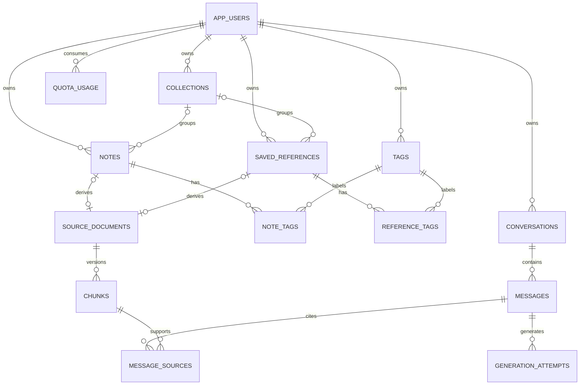

# Conceptual entity relationships

Status: Proposed — not migration DDL

Each source document belongs to exactly one note OR reference, never both; enforce an XOR check and unique source foreign keys. Optional ER lines alone do not express this constraint. All relationships must also match owner_id. Auth-managed tables are excluded from application migrations. Historical citation policy must be settled before destructive chunk deletion.
