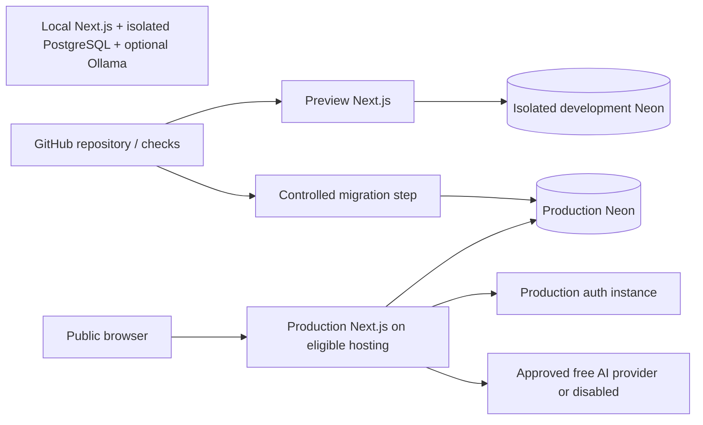

# Deployment topology

Status: Proposed

Preview must not use production credentials or copied private data. No service has been provisioned. Account-specific quotas, OAuth callbacks and hosting terms must be validated before activation. Local resources are alternatives for development, not production availability guarantees.
