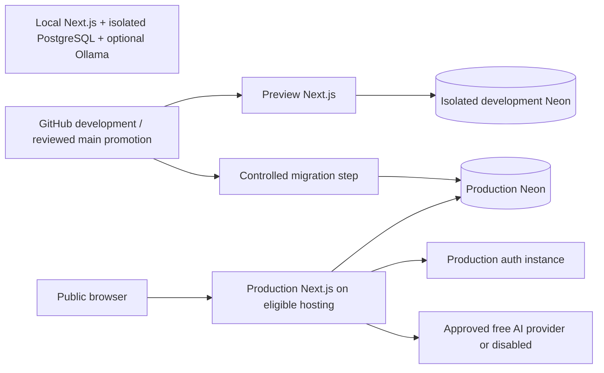

# Deployment topology

Status: Proposed — environment provisioning and GitHub automation are not configured

## Owner-requested promotion flow — 2026-11-27

The requested delivery path is local development → GitHub `development` → production. For this repository, interpret the existing GitHub `main` branch as the production promotion branch: tested changes land on `development`, then move to `main` through a reviewed pull request after release gates pass. Do not push development work directly to `main`. This avoids maintaining two production-named branches. Automatic deployment, branch protection, CI checks, Neon production project/branch, and hosting remain unconfigured and Proposed until verified.

Neon environments must be isolated: development points only to the development database/Auth branch; production points only to a separate production database/Auth branch. The requested one-time clean production reset is deferred until the production test run passes. Do not copy development or private user data into production as part of setup.

Preview must not use production credentials or copied private data. No service has been provisioned. Account-specific quotas, OAuth callbacks and hosting terms must be validated before activation. Local resources are alternatives for development, not production availability guarantees.
