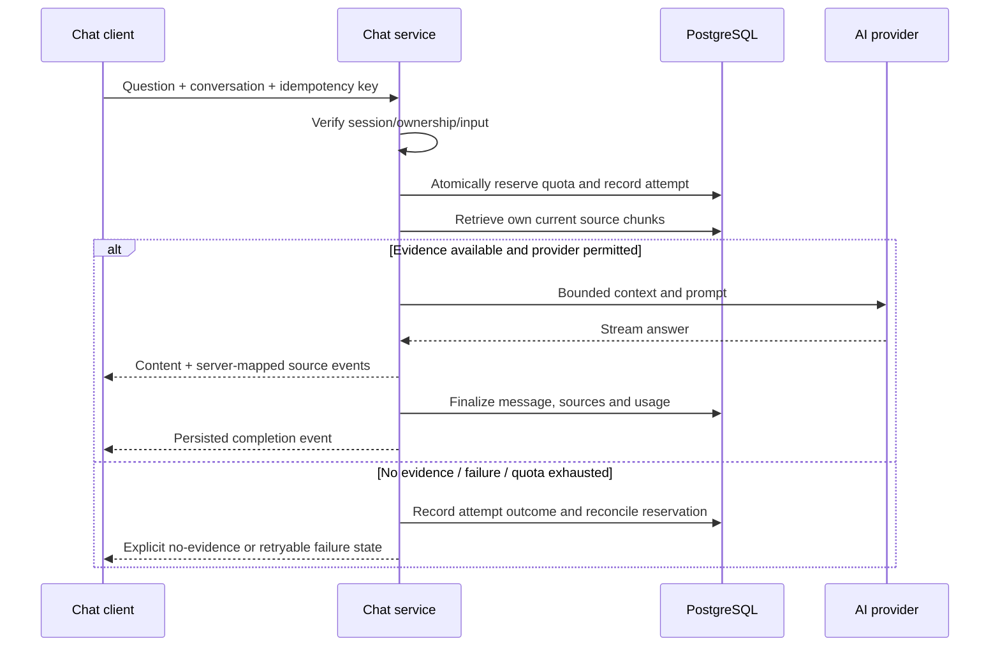

# Sequence diagrams

Status: Draft

## Autosave

```mermaid
sequenceDiagram
  participant C as Editor
  participant S as Next.js service
  participant D as PostgreSQL
  C->>S: save(noteId, expectedRevision, text)
  S->>S: Verify session, owner and input
  S->>D: Transaction: conditional update + index invalidation
  alt Revision matches and owned note exists
    D-->>S: New revision committed
    S-->>C: Saved revision
  else Stale revision or missing/deleted record
    D-->>S: No matching update
    S-->>C: Authorized conflict or generic unavailable
    C->>C: Preserve local edits; show resolution
  end
```

## Grounded chat



A terminated invocation may not execute cleanup: a later request must reconcile expired attempt leases conservatively. Completion is emitted only after final persistence; disconnected clients can reload attempt state.
