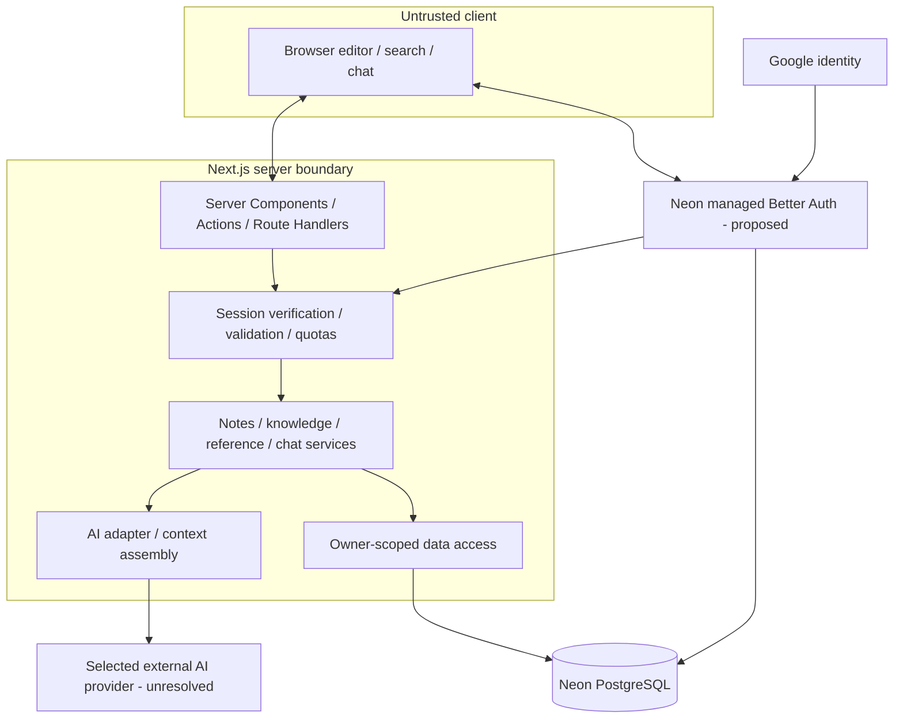

# Components and trust boundaries

Status: Proposed

Auth integration is proposed; the application never trusts browser-supplied ownership. Provider transmission includes only bounded authorized context under the chosen privacy policy. No MCP/tool executor or separate backend is present.
