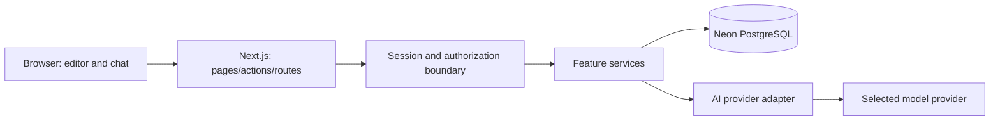

# System architecture

Status: Proposed

Use one modular Next.js App Router application on Vercel, with server-only services and Drizzle access to Neon PostgreSQL. Keep external AI behind a small application-owned adapter. No separate backend, vector database, Redis, or queue service is initially proposed.

Server Components load authorized page data; Client Components handle editor state, appearance, filters and streaming. Server Actions handle first-party form mutations; Route Handlers handle streaming chat and explicit import/export boundaries. Both call the same validation, authorization and feature services. Server Components call services directly rather than making internal HTTP requests.

Proposed organization: app/ for routing; features/{notes,references,knowledge,chat}/ for cohesive services and UI; lib/db, lib/auth, lib/ai for shared adapters; components/ui for shadcn primitives. Domain services own business rules; data access requires an authenticated owner identifier and cannot accept browser-supplied identity as authority.

Use URL parameters for shareable view/filter state, local React state for transient UI, and server data as the persistent source of truth. Introduce global state libraries only for demonstrated needs. Return typed, user-safe errors plus request IDs; redact content and credentials in logs. Private data must never enter cross-user shared caches.

See [system design](system-design.md), [decision register](architecture-decisions.md), [costs](../07-deployment/cost-analysis.md).

## Supporting overall design

- [Diagram index](diagrams/README.md)
- [Security/privacy baseline](security-architecture.md)
- [Database relationships](../03-technical/database-design.md)
- [User workflows](../01-product/user-workflows.md)
- [Release gates](../07-deployment/release-readiness.md)

Managed Neon Auth is recommended based on the current [official overview](https://neon.com/docs/auth/overview), which describes users and sessions stored in the database. The concrete SDK and session verification pattern must be validated in the auth feature specification. No extra backend service is justified by the present MVP.
